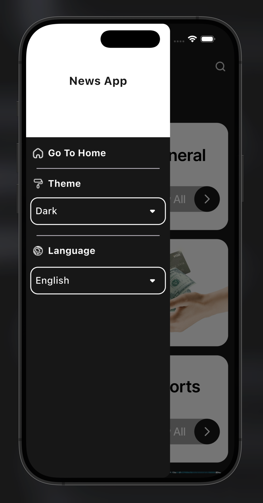

News Application

A modern Flutter news application that fetches real-time news from multiple sources using a public REST API.  
The app supports multiple categories, themes, and languages with a clean and responsive UI.

Features:
- Fetch real-time news using NewsAPI.org
- Multiple news categories (General, Business, Sports, Technology, Science, Health)
- Browse news by source
- Light & Dark theme support
- Language selection
- Clean and responsive UI
- Error handling for network requests

Technologies Used:
- Flutter
- Dart
- REST APIs (NewsAPI.org)

Screenshots:

